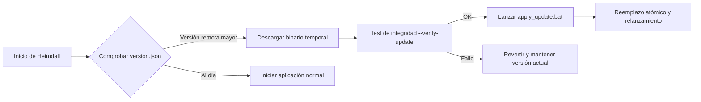

# 🛡️ HEIMDALL Sentinel System

<div align="center">


<p align="center">
  <strong>Suite unificada de monitorización de infraestructura, auditoría de copias de seguridad, inteligencia de amenazas y automatización operativa para entornos de misión crítica.</strong>
</p>

[Características](#-características-principales) •
[Módulos del Sistema](#-módulos-del-sistema) •
[Instalación y Despliegue](#-instalación-y-despliegue) •
[Sistema de Actualizaciones](#-sistema-de-actualizaciones-automáticas) •
[Estructura](#-estructura-del-proyecto) •
[Registro de Cambios](#-historial-de-versiones)

</div>

---

## 📋 Visión General

**Heimdall Sentinel System** es una suite de ingeniería de operaciones diseñada específicamente para operadores de sistemas, administradores de CPD y analistas de ciberseguridad. Su propósito es erradicar tareas manuales repetitivas, conciliar telemetría heterogénea entre múltiples fabricantes y acelerar el diagnóstico y respuesta ante incidencias de producción.

La aplicación opera bajo una interfaz de escritorio moderna (*CustomTkinter*), optimizada para pantallas de alta densidad (High-DPI), entornos multimonitor extendidos y conmutación dinámica entre temas claro y oscuro.

---

## ⚡ Características Principales

* 💾 **Conciliación Cruzada de Backups**: Auditoría combinada entre Veritas NetBackup (OpsCenter) y Commvault con desduplicación jerárquica inteligente.
* 📅 **Motor de Lotes de Fin de Semana (Criterio A)**: Emparejamiento cronológico estricto según ventana matutina de corte de informe y segregación de tareas en curso.
* 🔄 **Supervisión de Sincronización de Identidades (OIDSync)**: Diagnóstico en tiempo real de logs de sincronización de directorios con redacción automática del correo de incidencias.
* 🛡️ **Inteligencia de Amenazas WAF & AbuseIPDB**: Extracción y análisis de IPs reportadas en alertas perimetrales, con consulta de reputación API y exportación de listas de bloqueo.
* 📜 **Automatización de Políticas Checkpoint**: Generación asistida y particionada de scripts `.vbs` (SecureCRT) para comandos `mgmt_cli add host` y desprovisionamiento seguro.
* 🔍 **Sentinel Spotlight**: Búsqueda global instantánea en un clic (subredes CIDR, diagramas Microsoft Visio `.vsdx`, trazas SSL y WAF).
* 🌐 **NetKit Avanzado**: Calculadora de subredes, detector de solapamiento de redes IP, normalizador de direcciones MAC y feed Botnet C2 (Feodotracker).
* ☕ **Modo Vigía (Keep-Awake Sentinel)**: Micro-oscilación preventiva del cursor en segundo plano para evitar la suspensión del puesto durante guardias sin violar directivas de grupo (GPO).
* 🖥️ **Soporte Multimonitor Real**: Apertura y centrado geométrico de todos los modales, selectores y avisos en el monitor actual donde resida la aplicación.

---

## 🧩 Módulos del Sistema

### 1. Sentinel Backup Suite (Auditoría de Copias de Seguridad)
* **Ingesta Multi-Fabricante**: Procesa simultáneamente informes diarios CSV de **Veritas NetBackup (OpsCenter)** y **Commvault (Backup Job Summary)**.
* **Algoritmo de Desduplicación Jerárquica**: Si un trabajo multicanal (*multistream*) o relanzado presenta intentos fallidos pero culmina con éxito posteriormente, se consolida como **Terminado con éxito** y se registra la hora de subsanación.
* **Lote de Fin de Semana (Lunes de Operación)**: Ingesta en bloque de los 3 días del fin de semana (Viernes, Sábado y Domingo) emparejando automáticamente las ejecuciones nocturnas con los informes generados cada mañana.
* **Salida Ejecutiva**:
  * Informes individuales en formato Excel (`.xlsx`) con fórmulas nativas dinámicas y formato condicional.
  * Archivo consolidado de alertas en texto estilizado (`Alertas_Heimdall_FinDeSemana_DD-MM-AAAA.txt`) con balance de KPIs, subsanaciones respecto al día anterior y trabajos en curso.
  * Redacción automática del correo formal de relevo de guardia.

### 2. Identity Sync Engine (OIDSync)
* Ingesta directa de archivos `.log` o `.txt` generados por el proceso de sincronización de identidades corporativas.
* Detección automatizada de anomalías de aprovisionamiento, errores de conexión LDAP/Active Directory y cuentas bloqueadas.
* Acciones de un solo clic para copiar al portapapeles el **Asunto estandarizado** y el **Cuerpo de diagnóstico completo** listos para despacho.

### 3. WAF Security & AbuseIPDB Threat Intel
* Auditoría de eventos de tráfico anómalo registrados por Web Application Firewalls.
* Clasificación y aislamiento de direcciones IP maliciosas categorizadas en estado crítico (**Rojo**).
* Modal interactivo para consolidar y exportar listados `.txt` desduplicados para su inclusión en listas negras de cortafuegos perimetrales.
* Consulta en tiempo real de reputación contra la API oficial de **AbuseIPDB** con telemetría de cuotas restantes.

### 4. Generador de Scripts Checkpoint CLI (SecureCRT)
* Generador de scripts de automatización `.vbs` para consolas SecureCRT contra Checkpoint Gaia CLI (`mgmt_cli`).
* Soporte para asociación masiva de hosts a grupos de seguridad y modo Canary para borrado asistido.
* **Particionamiento Automático**: División en lotes de tamaño configurable (ej: 500 IPs por script) con pausas automáticas para evitar saturar el demonio `cpm` o agotar los sockets de gestión.

### 5. Sentinel Spotlight & Motor de Comandos
* Barra de búsqueda omnidireccional accesible desde la cabecera principal (`Ctrl+F` / Búsqueda global).
* Identificación automática de consultas:
  * Direcciones IP o notaciones CIDR $\rightarrow$ Cálculo instantáneo de subred.
  * Términos de topología $\rightarrow$ Búsqueda en esquemas de red Microsoft Visio (`.vsdx`).
  * Consultas operativas $\rightarrow$ Base de conocimiento semántica con árboles de referencia offline para **Checkpoint Gaia (Expert / Clish)**, **Linux** y **PowerShell**.

---

## 🚀 Instalación y Despliegue

### Opción A: Ejecutable Portátil Autónomo (Recomendado)
No requiere instalación de Python ni de dependencias externas.

1. Descarga la última versión desde el apartado de [Releases de GitHub](https://github.com/Hungrow/Heimdall/releases/latest).
2. Ejecuta `heimdall.exe`.
3. Al iniciar por primera vez, se generará la configuración base `config.json` en el directorio de ejecución.

### Opción B: Ejecución desde Código Fuente

#### Requisitos Previos
* Python 3.12 o superior (64-bit).
* Sistema Operativo: Windows 10 / 11 o Windows Server 2019+.

#### Preparación del Entorno
```bash
# 1. Clonar el repositorio
git clone https://github.com/Hungrow/Heimdall.git
cd Heimdall

# 2. Crear y activar entorno virtual
python -m venv venv
.\venv\Scripts\activate

# 3. Instalar librerías requeridas
pip install -r requirements.txt

# 4. Iniciar la aplicación
python heimdall.py
```

#### Compilación de Binario Propio
Para empaquetar el binario standalone utilizando las directivas de enlace y splash screen:
```powershell
pyinstaller heimdall.spec --noconfirm
```
El ejecutable resultante se ubicará en la carpeta `dist/heimdall.exe`.

---

## 🔄 Sistema de Actualizaciones Automáticas

Heimdall incorpora un subsistema de auto-actualización autónomo e idempotente ([`modules/updater.py`](modules/updater.py)):



1. **Detección**: Al arrancar (o bajo demanda desde Ajustes), consulta el archivo `version.json` ya sea en una URL HTTPS (GitHub Releases) o en una unidad compartida de red corporativa (`\\servidor\compartido`).
2. **Comparación Semántica**: Algoritmo numérico que evalúa revisiones mayores, menores y parches (ej. `2.2.7 > 2.2.6`).
3. **Reemplazo Transaccional**: Descarga `heimdall_update.tmp`, ejecuta un test de integridad en espacio de proceso aislado, genera un script batch autónomo (`apply_update.bat`), sustituye el binario y relanza Heimdall sin intervención manual.

---

## 📁 Estructura del Proyecto

```text
Heimdall/
├── modules/
│   ├── abuse_ip.py            # Integración API AbuseIPDB y cuotas
│   ├── backup_daily.py        # Motor de auditoría NetBackup y Commvault
│   ├── checkpoint_script.py   # Generador de scripts SecureCRT .vbs
│   ├── config_manager.py      # Gestor de persistencia JSON
│   ├── data_converter.py      # Transformador de datasets y exportaciones
│   ├── feodotracker.py        # Ingesta y cotejo de feeds C2
│   ├── gaia_simulator.py      # Emulador de consola Checkpoint Gaia
│   ├── net_tools.py           # Calculadora CIDR, solapamientos y MACs
│   ├── oidsync.py             # Parser de sincronización de identidades
│   ├── scvip_analyzer.py      # Extracción y templating documental SCVIP
│   ├── ssl_logs.py            # Monitorización y auditoría de eventos SSL
│   ├── updater.py             # Motor de auto-actualización y verificación
│   ├── visio_search.py        # Indexación semántica de archivos .vsdx
│   └── waf_analyzer.py        # Procesamiento de telemetría WAF
├── views/
│   └── view_interpreter.py    # Vista de aprendizaje e intérprete de comandos
├── data/                      # Esquemas, diccionarios y plantillas base
├── heimdall.py                # Entrada principal de la aplicación y GUI
├── heimdall.spec              # Especificación de empaquetado PyInstaller
├── config.example.json        # Plantilla de configuración sanitizada
├── version.json               # Manifiesto oficial de release y changelog
├── CHANGELOG.md               # Historial formal de versiones
└── README.md                  # Documentación principal del repositorio
```

---

## 🔒 Seguridad y Buenas Prácticas

* **Credenciales y API Keys**: Las claves de acceso a APIs externas (ej. AbuseIPDB) se almacenan localmente en `config.json` y nunca deben subirse al control de versiones. Se suministra [config.example.json](config.example.json) como plantilla de referencia.
* **Integridad de Datos**: Ningún informe original procesado por Heimdall es sobreescrito. Todos los reportes se generan como entregables independientes con sellado de fecha y hora.
* **Privacidad**: El procesamiento de archivos CSV, logs y PDFs se realiza de manera 100% local en la máquina cliente.

---

## 📜 Historial de Versiones

Consulta el archivo [CHANGELOG.md](CHANGELOG.md) para acceder al registro detallado de cada versión.

* **v2.2.7 (Actual)**:
  * Soporte multimonitor integral para popups, diálogos nativos y selectores de archivos en pantallas extendidas.
  * Reorganización del módulo OIDSync con flujo directo al cargar archivos.
  * Rediseño visual del resumen consolidado TXT de backups en tarjetas limpias y legibles.
  * Algoritmo de emparejamiento estricto Criterio A para lotes de fin de semana.
  * Barra superior adaptativa para prevenir solapamiento en resoluciones de alto DPI.

---

<div align="center">
  <sub>Desarrollado y mantenido por <strong>Hungrow</strong>. Heimdall Sentinel System © 2026.</sub>
</div>
